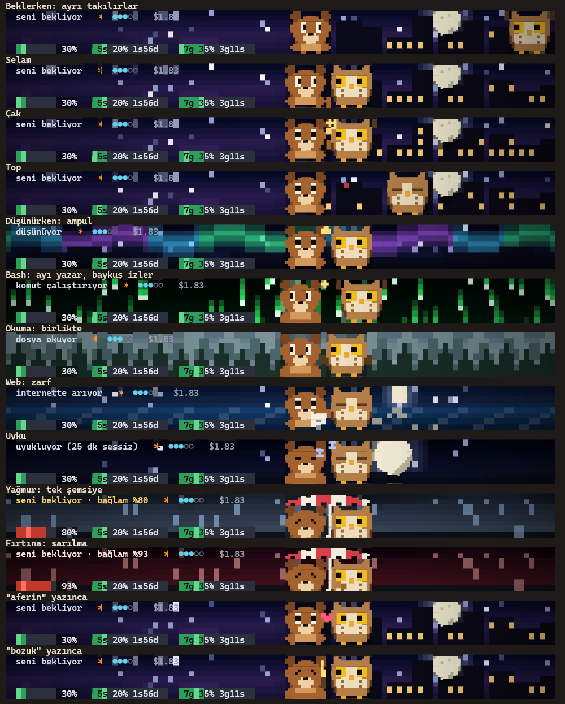

# Ayı ile Baykuş

Claude Code durum çubuğunu, oturumun o anki hâline göre değişen piksel bir sahneye çevirir. Bir ayı ile bir baykuş birlikte yaşar: Bash çalışırken ayı yazar, baykuş tezahürat yapar; bağlam dolunca tek şemsiyenin altına girerler.

**Sayfa:** https://anillaksu.github.io/ayi-baykus/



## Kurulum

```
claude plugin marketplace add anillaksu/ayi-baykus
claude plugin install ayi-baykus@ayi-baykus
```

Sonra Claude Code içinde:

```
/ayi-baykus:kur
```

Eklenti sistemi durum çubuğunu kendi başına açamadığı için bu son adım gerekli. Önceki ayarınız yedeklenir.

Kaldırmak için önce `/ayi-baykus:kaldir`, sonra `claude plugin uninstall ayi-baykus@ayi-baykus`. Önceki durum çubuğunuz geri gelir.

Sahneleri beklemeden izlemek için:

```
bash ~/.claude/ayi-baykus/canlandir.sh ikisi 60
```

`ikisi` yerine `yagmur`, `firtina` ya da `dusunce` yazılabilir.

## Gereksinimler

- Bash 4.3 veya üstü (Windows'ta Git Bash; macOS'un kendi Bash'i eski, `brew install bash`)
- `jq`
- 24-bit renkli terminal

## Terminaller

En iyi görüntü Windows Terminal'de: karakterler hücre başına 8 piksel çizilir. Başka terminallerde betik çeyrek bloklara düşer, karakterler daha kaba görünür. Terminaliniz Unicode oktantlarını destekliyorsa ayarlarda `SL_OKTANT=1` ile açabilirsiniz.

## Ne yapıyorlar

| Durum | Sahne |
|---|---|
| Beklerken | 48 saniyelik döngü: ayrı takılma, selam, çak, top |
| Düşünürken | Baykuş ampulü getirir |
| Bash | Ayı yazar, baykuş tezahürat yapar |
| Kod yazarken | Ayı baykuşu kovalar |
| Dosya okurken | Yan yana okurlar, baykuş soru sorar |
| Web | Baykuş uçar, zarfla döner |
| Bağlam %75 veya sınır %80 | Yağmur, tek şemsiye |
| Bağlam %90 | Fırtına, ayı baykuşa sarılır |
| "aferin", "harika" yazınca | Kalp |
| "bozuk", "olmadı" yazınca | Baykuş ayıyı teselli eder |

Yazılar ve duygu sözcükleri şimdilik yalnız Türkçe.

## Sınırlar

- Kare hızı en çok saniyede 1, Claude Code daha sık yenilemiyor.
- Fare ve klavye olayı alınamıyor. Karakterler oturumda olanlara tepki veriyor.
- Claude Code'un kendi alt satırına (`auto mode on`) çizilemiyor.
- Terminal başına yaklaşık %3 işlemci (12 çekirdekli Windows makinede ölçüldü).

## Lisans

MIT. Ayrıntı: [LICENSE](LICENSE). Bilgi satırları MIT lisanslı avenoxstatusline uyarlamasıdır.
